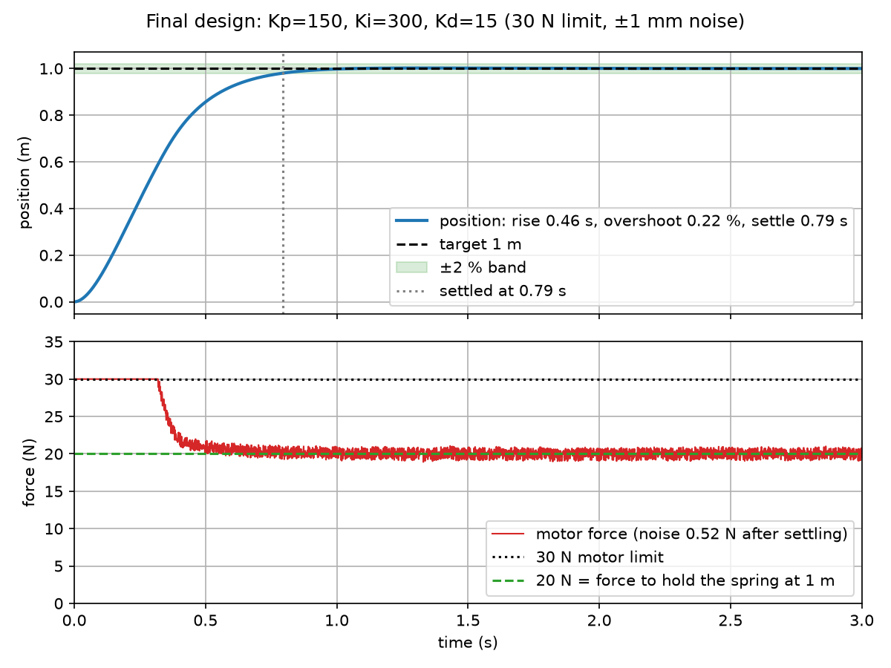

# PID Control from Scratch

A PID controller for a mass–spring–damper, written from zero in NumPy and Matplotlib
(no control libraries). Made for the Modern Monk Labs Physical AI intern assignment.

**Plant:** m·x'' + c·x' + k·x = u, with m = 1 kg, c = 10 N·s/m, k = 20 N/m.
**Goal:** move the mass to 1 m with a 30 N motor limit and ±1 mm sensor noise.

## Result

Final gains: **Kp = 150, Ki = 300, Kd = 15**,
with clamping anti-windup, a filtered derivative (τ = 20 ms) and derivative on measurement.

| Rise time | Overshoot | Settling time (2%) | Force noise | Steady-state error |
|---|---|---|---|---|
| 0.464 s | 0.22 % | 0.794 s | 0.52 N | 0 |

My targets were overshoot < 2 %, settling < 1 s and force noise < 1 N.
I chose these gains as a balance between motor wear (low force noise) and robustness:
they still meet every target with a 2 kg load, and when pushed past their limits
(e.g. a 100 ms controller update) they degrade gently instead of oscillating.
The full reasoning is in the report.

## Quick start

    git clone <your repo URL>
    cd assign_mmL
    python3 -m venv .venv
    source .venv/bin/activate        # Windows: .venv\Scripts\activate
    pip install -r requirements.txt

    python checks.py                 # 11 checks: simulation vs theory, all should PASS
    python make_figures.py           # regenerates every graph into figures/

The sensor noise uses a fixed random seed, so everyone gets identical graphs.

## Files

| File | What it does |
|---|---|
| `plant.py` | Simulates the mass–spring–damper (semi-implicit Euler, dt = 1 ms), plus the 1/(s+1)³ system |
| `pid.py` | The PID class: limits, clamping anti-windup, derivative filter, derivative on measurement |
| `metrics.py` | Rise time, overshoot, settling time and steady-state error from a response |
| `sweep.py` | Prints the tables: P sweep vs formulas, P/PI/PD/PID, windup, noise, kick, update rate |
| `zn.py` | Ziegler–Nichols: finds Ku and Tu on 1/(s+1)³ and computes the ZN gains |
| `tune.py` | Compares candidate gains against my targets and stress-tests the final choice |
| `checks.py` | Automatic checks that the simulation agrees with the formulas |
| `make_figures.py` | Draws every figure in the report |

## Figures

`python make_figures.py` saves all 14 into `figures/`.

| File | Shows | Report section |
|---|---|---|
| `fig01_open_loop.png` | Open-loop response (constant 20 N, no controller) | 3 |
| `fig02_metrics.png` | The four performance measures marked on one response | 4 |
| `fig03_p_sweep.png` | P only at several gains: always stops short of the target | 5 |
| `fig04_pi.png` | Adding I: the remaining error goes to zero | 5 |
| `fig05_pd.png` | Adding D: overshoot damped | 5 |
| `fig06_compare.png` | P vs PI vs PD vs PID | 6 |
| `fig07_parts.png` | The P, I and D forces over time | 6 |
| `fig08_windup.png` | Integral windup at 30 N, fixed by anti-windup | 7a |
| `fig09_noise.png` | ±1 mm sensor noise makes D jumpy, fixed by a filter | 7b |
| `fig10_kick.png` | Derivative kick, fixed by derivative on measurement | 7c |
| `fig11_period.png` | Effect of a slower controller update | 7d |
| `fig12_ku.png` | Raising P on 1/(s+1)³ until it swings steadily (Ku, Tu) | 8 |
| `fig13_zn.png` | Ziegler–Nichols gains, then improved by hand | 8 |
| `fig14_final.png` | Final design with every real-world problem switched on | 6, 9 |

## Checks

`checks.py` verifies, among others:
- P-only final position equals Kp/(k+Kp)
- P-only overshoot matches the damping-ratio formula (within 0.5 %)
- at rest, the integral alone holds the spring (I = k·r = 20 N)
- the force never exceeds the 30 N limit
- anti-windup reduces overshoot (12.25 % → 0 %)
- derivative on measurement removes the kick (30 300 N → 300 N)
- the final gains meet all three targets

## Author

Sannidhi D Math